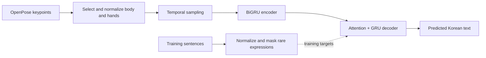
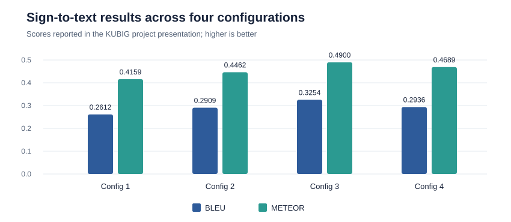

# Korean Sign Language to text from human keypoints

This repository contains my sign-to-text work from the [KUBIG Cheongseol team project](https://github.com/KU-BIG/KUBIG_2025_SPRING/tree/main/KUBIG%20CONFERENCE/Image%20processing). For more information about the two-way translation project, see the team repository.

## Motivation

Body and hand keypoints provide a compact representation of sign-language movement. Translating them into Korean text remained difficult because many target sentences contained rare times, locations, and addresses.

## My contribution

- Matched OpenPose keypoint files with Korean sentences, selected body and hand coordinates, and split the data by sentence ID.
- Normalized keypoints and augmented sequences through temporal sampling. Normalized target sentences and replaced rare time, location, and address expressions with placeholders.
- Implemented a BiGRU encoder with an attention-based GRU decoder for keypoint-to-text translation.

## Results

The initial model struggled with rare expressions. After text normalization, masking, and decoding changes, the best reported configuration reached **BLEU 0.3254** and **METEOR 0.4900**.

*Four sign-to-text configurations from my KUBIG presentation.*

## Discussion

Preparing target text was important for this keypoint-to-text task. The fire-alert-only corpus and rare names limited generalization. A video demonstration also used MediaPipe keypoints, which differed from the OpenPose keypoints used for training.

## Code structure

| Stage | Files |
| --- | --- |
| Match and split samples | [`merge_keypoints.py`](merge_keypoints.py), [`split_samples.py`](split_samples.py) |
| Normalize, mask, and augment | [`normalize_keypoints.py`](normalize_keypoints.py), [`mask_text.py`](mask_text.py), [`augment_frames.py`](augment_frames.py) |
| Prepare arrays and train | [`prepare_arrays.py`](prepare_arrays.py), [`model.py`](model.py), [`train.py`](train.py) |
| Predict and inspect | [`predict.py`](predict.py), [`notebooks/sign_to_text.ipynb`](notebooks/sign_to_text.ipynb) |
