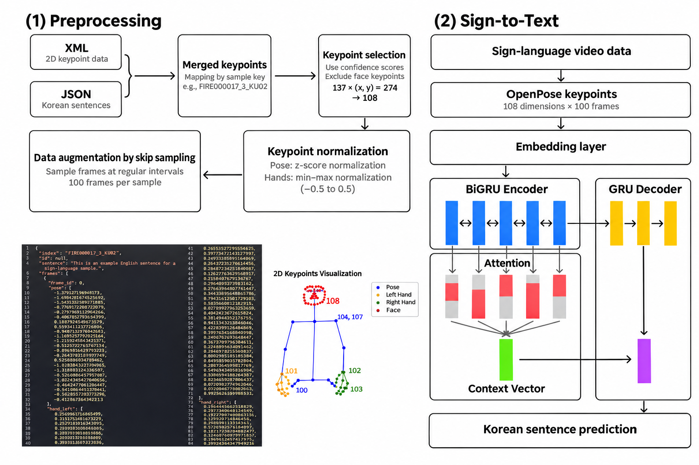

# Korean Sign Language to text from human keypoints

This repository contains my sign-to-text work from the [KUBIG Cheongseol team project](https://github.com/KU-BIG/KUBIG_2025_SPRING/tree/main/KUBIG%20CONFERENCE/Image%20processing). For more information about the two-way translation project, see the team repository.

## Motivation

- At a Coldplay concert, I saw deaf concertgoers experience the performance through sign-language interpretation.
- The team watched the Korean film 'Cheongseol' together and discussed how deaf people may miss audible alarms or calls in emergencies.
- These experiences motivated me to work on real-time sign-language translation.

## My contribution

1. **Preprocessing**
   - Matched XML keypoint files generated by OpenPose with Korean sentences, selected body and hand coordinates relevant to sign language, and normalized them to account for differences between signers.
   - Augmented sequences through temporal sampling for training.
   - Normalized target sentences and replaced rare time, location, and address expressions with placeholders to stabilize training.

2. **Sign-to-Text Component**
   - Implemented a BiGRU encoder with an attention-based GRU decoder for keypoint-to-text translation.

*Preprocessing and sign-to-text architecture from my KUBIG poster*

## Results

The initial model struggled with rare expressions. After text normalization, masking, and refinements to training strategies, the best reported configuration reached **BLEU 0.3254** and **METEOR 0.4900**.

| Model | Top-k | Top-p | Repetition penalty | Label smoothing | TFR | BLEU | METEOR | ROUGE |
| ---: | ---: | ---: | ---: | ---: | ---: | ---: | ---: | ---: |
| 1 | 10 | 0.85 | 1.2 | 0.1 | 0.3 | 0.2612 | 0.4159 | 0.0000 |
| 2 | 5 | 0.9 | 1.2 | 0.1 | 0.3 | 0.2909 | 0.4462 | 0.0000 |
| **3** | **5** | **0.9** | **0.9** | **0.1** | **0.5** | **0.3254** | **0.4900** | **0.0016** |
| 4 | 5 | 0.9 | 1.2 | 0.1 | 0.5 | 0.2936 | 0.4689 | 0.0016 |

*Configurations and metrics reproduced from my KUBIG presentation; Model 3 had the highest BLEU and METEOR.*

## Limitations

- **Data:** Training used the fire-alert subset, limiting the range of contexts. Rare place names, times, and addresses remained difficult despite text normalization and masking.
- **Keypoints and demonstration:** The demonstration used MediaPipe, while training used OpenPose, creating an input mismatch.
- **Next steps:** Broader training data, more complete masking, and consistent keypoint extraction would help test whether the model generalizes beyond the current setting.

## Code structure

| Stage | Files |
| --- | --- |
| Match and split samples | [`merge_keypoints.py`](merge_keypoints.py), [`split_samples.py`](split_samples.py) |
| Normalize, mask, and augment | [`normalize_keypoints.py`](normalize_keypoints.py), [`mask_text.py`](mask_text.py), [`augment_frames.py`](augment_frames.py) |
| Prepare arrays and train | [`prepare_arrays.py`](prepare_arrays.py), [`model.py`](model.py), [`train.py`](train.py) |
| Predict and inspect | [`predict.py`](predict.py), [`notebooks/sign_to_text.ipynb`](notebooks/sign_to_text.ipynb) |
