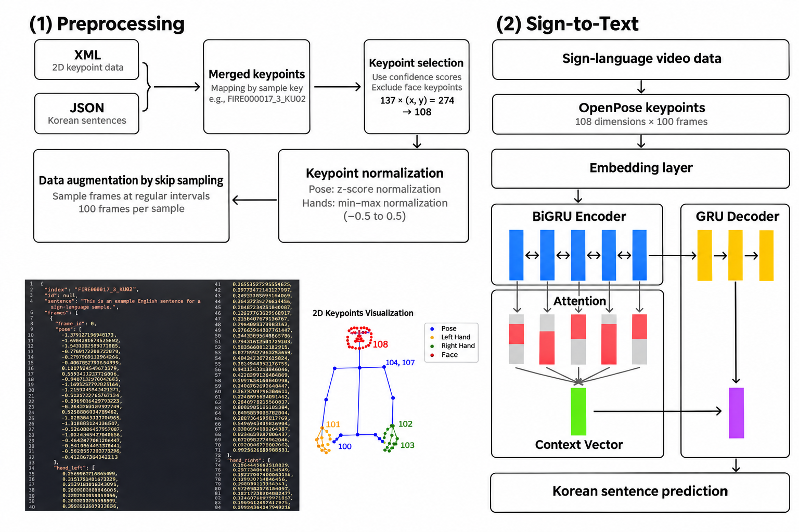

# Korean Sign Language Translation from Human Keypoints 

This repository contains my sign-to-text work from the [KUBIG Cheongseol team project](https://github.com/KU-BIG/KUBIG_2025_SPRING/tree/main/KUBIG%20CONFERENCE/Image%20processing). For more information about the two-way translation project, see the team repository.

## Motivation

- At a Coldplay concert, I saw deaf concertgoers experience the performance through sign-language interpretation.
- The team watched the Korean film 'Cheongseol' together and discussed how deaf people may miss audible alarms or calls in emergencies.
- These experiences motivated me to work on real-time sign-language translation.

## My contribution

1. **Preprocessing**
   - Matched XML keypoint files generated by OpenPose with Korean sentences, selected body and hand coordinates relevant to sign language, and normalized them to account for differences between signers.
   - Augmented sequences through temporal sampling for training.
   - Normalized target sentences and masked rare time, location, and address expressions using placeholder tokens to stabilize training.

2. **Sign-to-Text Component**
   - Implemented a BiGRU encoder with an attention-based GRU decoder for keypoint-to-text translation.


*Preprocessing and sign-to-text architecture from my KUBIG poster*

## Results

The initial model struggled with rare expressions. After text normalization, masking, and refining training strategies, the best reported configuration reached **BLEU 0.3254** and **METEOR 0.4900**.

| Model | Top-k | Top-p | Repetition penalty | Label smoothing | TFR | BLEU | METEOR | ROUGE |
| ---: | ---: | ---: | ---: | ---: | ---: | ---: | ---: | ---: |
| 1 | 10 | 0.85 | 1.2 | 0.1 | 0.3 | 0.2612 | 0.4159 | 0.0000 |
| 2 | 5 | 0.9 | 1.2 | 0.1 | 0.3 | 0.2909 | 0.4462 | 0.0000 |
| **3** | **5** | **0.9** | **0.9** | **0.1** | **0.5** | **0.3254** | **0.4900** | **0.0016** |
| 4 | 5 | 0.9 | 1.2 | 0.1 | 0.5 | 0.2936 | 0.4689 | 0.0016 |

*Configurations and metrics reproduced from my KUBIG presentation; Model 3 had the highest BLEU and METEOR.*

## Discussions

- **Data:** Training used the fire-alert subset, limiting the range of contexts. Rare place names, times, and addresses remained difficult despite text normalization and masking.
- **Keypoint extraction:** Extracting keypoints was challenging, with more than 15% of expected keypoints undetected. The demonstration used MediaPipe, while the model was trained on OpenPose keypoints, creating an input mismatch.
- **Next steps:** Broader training data, more complete masking, and consistent keypoint extraction would help test whether the model generalizes beyond the current setting.

## Code structure

| Stage | Files |
| --- | --- |
| Match and split samples | [`merge_keypoints.py`](merge_keypoints.py), [`split_samples.py`](split_samples.py) |
| Normalize, mask, and augment | [`normalize_keypoints.py`](normalize_keypoints.py), [`normalize_text.py`](normalize_text.py), [`mask_text.py`](mask_text.py), [`augment_frames.py`](augment_frames.py) |
| Prepare arrays and train | [`prepare_arrays.py`](prepare_arrays.py), [`dataset.py`](dataset.py), [`model.py`](model.py), [`train.py`](train.py) |
| Evaluate and predict | [`evaluation.py`](evaluation.py), [`predict.py`](predict.py) |
| Optional video demonstration | [`video_demo.py`](video_demo.py), [`requirements-demo.txt`](requirements-demo.txt) |
| Original experiments | [`notebooks/sign_to_text.ipynb`](notebooks/sign_to_text.ipynb) |

## Running the code

Run commands from the repository root. Use a separate virtual environment:

```bash
python -m venv .venv
source .venv/bin/activate
python -m pip install -r requirements.txt
```

For interactive exploration, install `requirements-notebook.txt` instead. The
notebook now includes section headings linking each stage to its Python module.
The Python scripts expose the main workflow; the notebook also preserves optional
plots and alternative experiments. Datasets, checkpoints, and generated outputs
are not committed.

Supply the source XML keypoints and matching JSON annotations separately. Use new
output directories when changing splits or preprocessing settings.

```bash
python merge_keypoints.py --xml-root path/to/tact_keypoints/FIRE --json-root path/to/tact_morpheme/FIRE --output-dir work/merged
python split_samples.py --input-dir work/merged --output-dir work/split --seed 42
python normalize_keypoints.py --train-dir work/split/train --val-dir work/split/val --output-dir work/normalized
python normalize_text.py work/normalized/train work/normalized/val
python mask_text.py work/normalized/train
python mask_text.py work/normalized/val
python augment_frames.py --input-dir work/normalized/train --output-dir work/augmented --frames 100 --seed 42
python prepare_arrays.py --train-dir work/augmented --val-dir work/normalized/val --output-dir work/prepared
python train.py --data-dir work/prepared
python evaluation.py --data-dir work/prepared --checkpoint checkpoints/best_checkpoint.pt --json-dir work/normalized/val --output work/val_predictions.csv
```

The CLI follows the final 100-frame augmentation and Model_2 training path. It
adds deterministic splitting/augmentation seeds, consistent `X_part_` filenames,
and joint X/y/sample-ID writing. The notebook's earlier 50-frame augmentation,
Model_1 routine, diagnostics, and video prototypes are preserved as alternatives.
The model classes and masking rules match their notebook definitions.

`evaluation.py` samples translations with top-k/top-p filtering; `predict.py`
uses direct greedy decoding. The default repetition penalty is 1.2, matching the
notebook; pass `--repetition-penalty 0.9` for the value listed for Model 3 in the
presentation table. Published presentation metrics are historical results, not
new measurements from this cleanup.

The optional video demo requires `requirements-demo.txt` and retains the original
MediaPipe prototype, including its decoding routine. It differs from `predict.py`.
Training uses OpenPose landmarks, so the demo is not an equivalent input pipeline.
Use a MediaPipe release that provides the legacy `mp.solutions` API. Saved slot
values used to restore masked text come from annotations, not from model inference.

The historical training loop compares shifted targets with an output tensor whose
first position is left at zero; the video prototype also begins from that zero
output. These indexing issues are preserved here to keep the original experiments
identifiable. Correcting them would change training/decoding behavior and require
new evaluation; the historical metrics should not be treated as validation of a
corrected implementation.

Check Python/notebook syntax and shared definitions without starting training:

```bash
python checks/check_notebook.py
```
